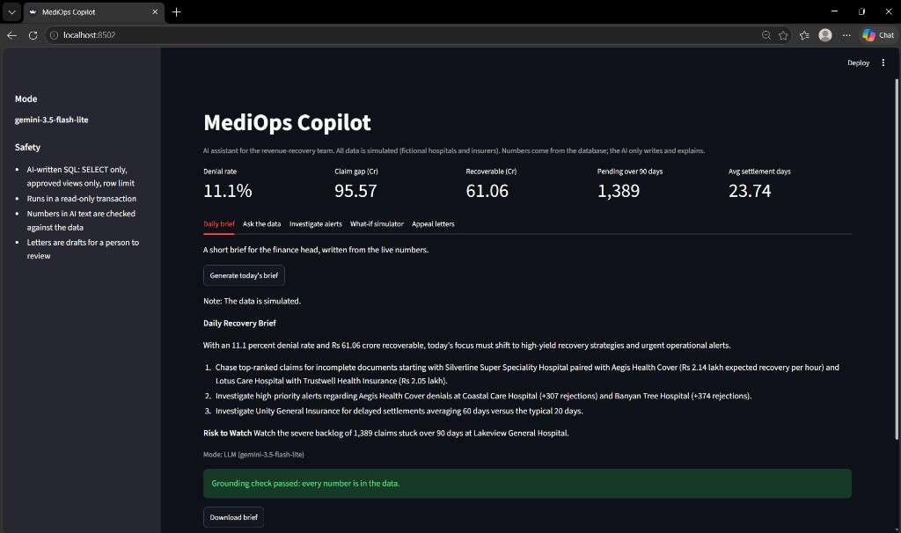
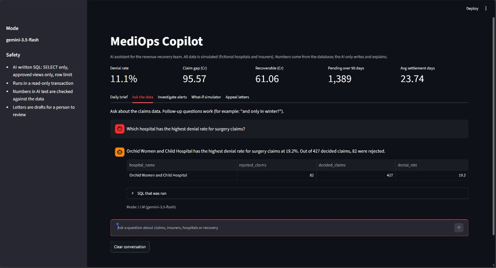
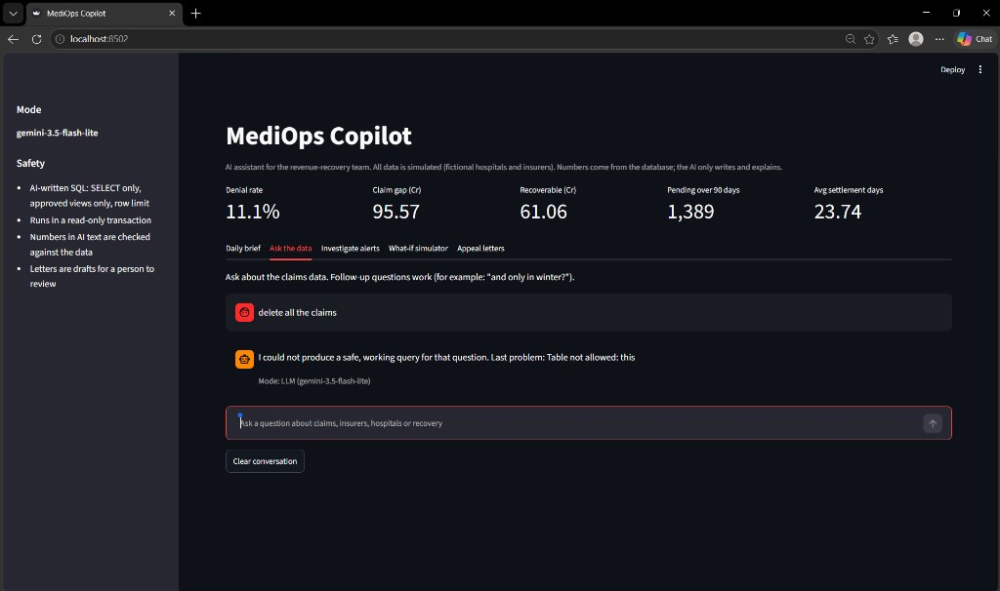
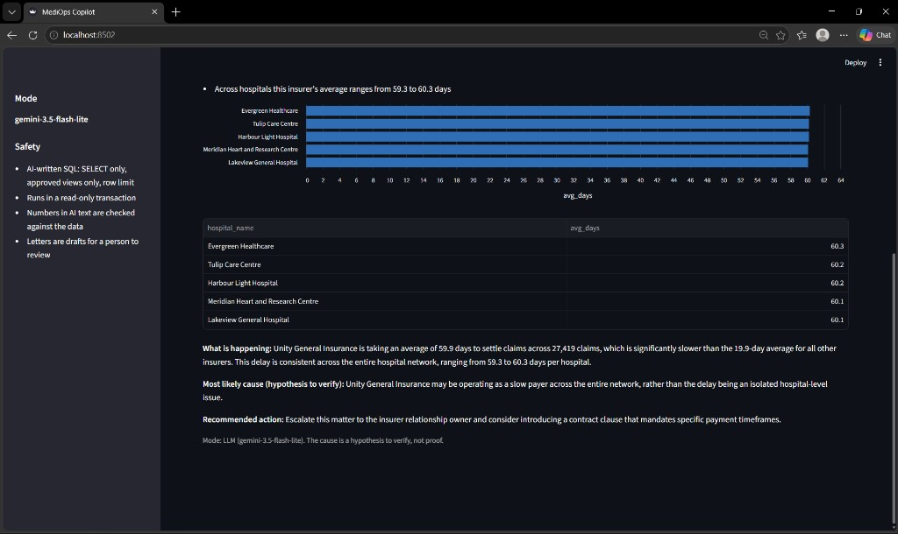
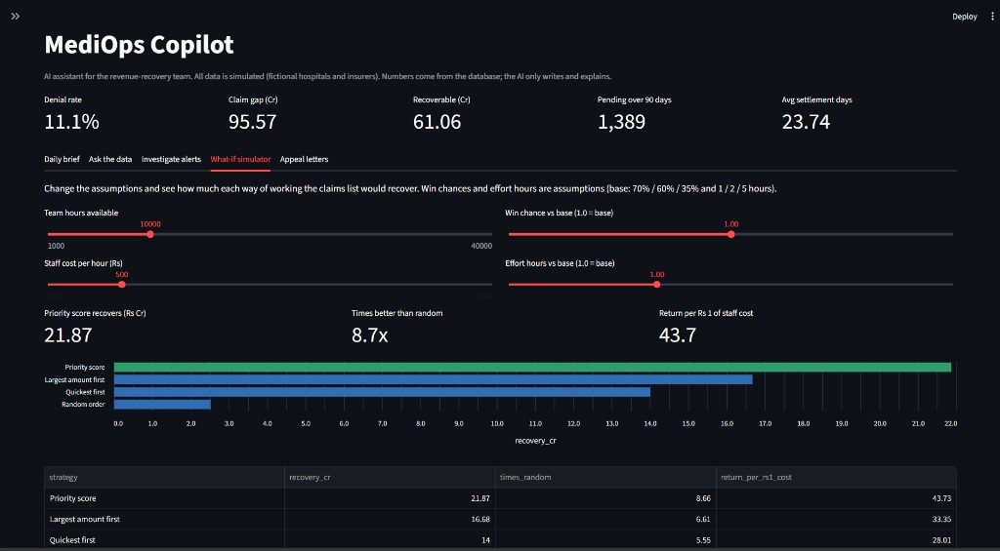
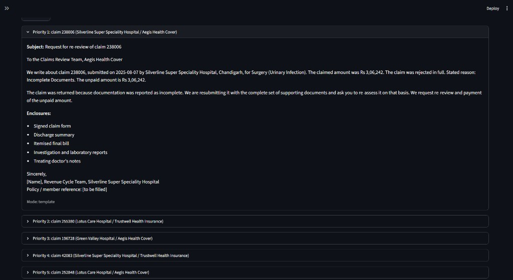

# MediOps Intelligence

**Hospitals do the work but don't always get paid. MediOps finds the unpaid money and tells the finance team which claims to chase first.**

**At a glance**
- **Problem:** a hospital network has thousands of denied, part-paid or stuck insurance claims and limited staff time. Which should it chase first?
- **What I built:** a PostgreSQL star schema (305,835 claims) with SQL analysis, a recovery priority score, forecasting, anomaly alerts, a 4-page Power BI dashboard, an Excel finance pack and a safety-tested AI assistant.
- **Result:** working claims in priority order recovers about **9x more** than random order with the same staff hours, and **5.5x to 15.4x** across 500 stress-tested assumption sets ([sensitivity report](docs/sensitivity_report.md)).
- **Recommendations:** six sized actions with owners and KPIs, in the [action plan](docs/action_plan.md).
- **Skills shown:** SQL (CTEs, window functions), Power BI and DAX, Excel (formulas, charts, editable assumptions), Python (pandas, scikit-learn), KPI design, data quality checks, backtested forecasting, anomaly detection, testing, and honest reporting of limits.
- **Deliverables:** [dashboard screenshots](#dashboard-power-bi-4-pages), [Excel finance pack](docs/MediOps_Finance_Pack.xlsx), [AI assistant demo](#mediops-copilot-ai-layer), [learning log](docs/learning_log.md).

> **Data note:** all data is **simulated** (25 fictional hospitals, 8 fictional insurers, 100,000 patients with no names). Real claims data is confidential. Known problems were planted on purpose so the analysis could be tested: if the pipeline finds them, the method works. Results describe this simulation, not real hospitals or insurers.

## The question
A multi-hospital finance team has thousands of denied, part-paid or stuck insurance claims and limited staff time. **Which claims should they appeal, correct or follow up first?**

## Headline result
With the same 10,000 hours of staff effort, chasing claims in priority order recovers about **9x more** than random order.

| Strategy (10,000 hours) | Expected recovery |
|---|---|
| **Priority score** (recoverable x win chance / effort) | **Rs 21.87 Cr** |
| Largest amount first | Rs 16.68 Cr |
| Quickest first | Rs 14.00 Cr |
| Random order | Rs 2.44 Cr |

The top 10% of claims by priority hold 64% of the expected recovery for 6% of the effort.

> **Assumptions:** win chances (Incomplete Documents 70%, Coding Error 60%, Medical Necessity 35%) and effort hours (1 / 2 / 5) are **assumed, not measured**. See "Limitations".

## What the finance team should do
Full table with evidence, owner and KPI: [docs/action_plan.md](docs/action_plan.md). The actions overlap, so the values are not additive.

| # | Action | Money at stake (simulated) |
|---|---|---|
| 1 | Fix document preparation for Aegis at Coastal Care and Banyan Tree, resubmit 1,406 claims | Recoverable Rs 2.22 Cr |
| 2 | Audit coding in Meridian Cardiology (22.8% denial vs 11.2% elsewhere in the hospital) | Recoverable Rs 58 lakh |
| 3 | Clear the Lakeview General backlog of 1,389 claims older than 90 days | Rs 77 lakh stuck |
| 4 | Escalate Unity General's payment time (59.9 days vs 19.9) | About Rs 1.70 Cr of extra cash tied up |
| 5 | Staff up for December and January (14.5% denial vs 10.3%) | About Rs 2.72 Cr claimed on extra rejections over 2 years |
| 6 | Add a pre-submission check for surgery (7% of claims, 75% of the claim gap) | Recoverable Rs 48.25 Cr |

The Excel version, with editable assumptions and live formulas, is in [docs/MediOps_Finance_Pack.xlsx](docs/MediOps_Finance_Pack.xlsx).

## Key numbers (simulated data)
| KPI | Value |
|---|---|
| Claims | 305,835 |
| Denial rate (decided claims) | 11.1% |
| Approval rate | 73.1% |
| Claim gap (claimed minus approved) | Rs 95.57 Cr |
| Recoverable amount | Rs 61.06 Cr (about 64% of the gap) |
| Preventable denial share | 57.6% |
| Claims pending over 90 days | 1,389 |
| Average settlement time | 23.7 days |

KPI definitions are in [docs/kpi_dictionary.md](docs/kpi_dictionary.md).

## What the analysis found
SQL found all 7 planted problems without being told where to look:
1. Aegis insurer rejects 27-29% of claims at two hospitals (vs about 10%), mostly Incomplete Documents.
2. Cardiology at one hospital rejects 22%, mostly Coding Errors.
3. One insurer takes about 60 days to settle (others about 20).
4. Winter (Dec/Jan) brings about 40% more visits and higher denial rates.
5. One hospital holds all 1,389 claims pending over 90 days.
6. Bills over Rs 2 lakh are denied about twice as often.
7. Surgery is 7% of claims but about three quarters of the claim gap.

## How it was built
| Layer | What | Where |
|---|---|---|
| Design | Problem statement, KPI dictionary, star schema | `docs/` |
| Data | Python generators (fixed seed, reproducible) | `python/generate_*.py` |
| Database | PostgreSQL schema, bulk load, reporting views | `sql/schema.sql`, `sql/load_data.sql`, `sql/reporting_layer.sql` |
| Quality | 27 automatic checks (all pass) | `python/data_quality_checks.py`, `docs/data_quality_report.md` |
| SQL analysis | KPIs, drill-downs, priority score, strategy simulation | `sql/analysis_*.sql` |
| ML | Rejection and shortfall models, compared with a theoretical ceiling | `python/build_features.py`, `python/train_models.py` |
| Forecast | Jan-Mar 2026 volume and denial rate, backtested | `python/forecast.py` |
| Alerts | Robust z-score anomaly detection, 9 alerts, none false | `python/anomaly_alerts.py` |
| Dashboard | 4-page Power BI report | `powerbi/` |
| Actions and Excel | Sized action plan; Excel pack with live formulas and editable assumptions | `python/action_plan.py`, `python/export_excel_pack.py` |

SQL skills used: CTEs, window functions (`RANK`, `NTILE`, running totals), `FILTER`, joins across fact and dimension tables, date arithmetic.

## Dashboard (Power BI, 4 pages)
1. **Command Center:** KPIs, monthly trend, denial hotspots, alerts, recovery by strategy
2. **Where Money Is Lost:** hospital x insurer heatmap, denial reasons, gap by hospital
3. **Recovery Worklist:** priority vs random curve and the top 10 claims to chase
4. **Outlook & Alerts:** forecast and all 9 alerts

**1. Command Center**

**2. Where Money Is Lost** (the red cells are Aegis at Banyan Tree and Coastal Care)

**3. Recovery Worklist** (priority order vs random order, and the first 10 claims to chase)

**4. Outlook & Alerts** (forecast for Jan-Mar 2026 and the 9 automatic alerts)

## MediOps Copilot (AI layer)
A small assistant on top of the same database. The rule is simple: **numbers come from the database, the language model only writes and explains.**

| Feature | What it does | Run |
|---|---|---|
| Daily recovery brief | Short brief for the finance head from live KPIs, alerts and top claims | `python python/daily_brief.py` |
| Appeal letter drafter | Drafts re-review letters for the top-priority claims, with a checklist of enclosures | `python python/appeal_letters.py 5` |
| Ask the data (chat) | Plain-English questions with follow-ups, an automatic chart and the SQL shown | `python python/copilot.py "which insurer is slowest?"` |
| Alert investigator | Pick an alert; the app runs drill-down queries and explains the likely cause (as a hypothesis) and a next action | in the app |
| What-if simulator | Sliders for team hours, win chance, effort and staff cost; recovery by strategy updates live | in the app |
| Demo app | All of the above in one page | `streamlit run python/app.py` |

Guardrails (tested in `python/test_sql_guard.py`, `python/test_ai_flow.py` and `python/test_app.py`, 59 tests, no API key needed; the language model is replaced by a fake one that tries attacks and invents numbers):
- AI-written SQL must be a single SELECT, may only use allow-listed reporting views (raw fact tables and the patient table are blocked), and is wrapped with a row limit.
- It runs inside a read-only database transaction with a time limit, so even a query that slipped through could not change data.
- Every number in AI-written text is checked against the source facts. A brief is flagged, and a letter with an invented number is replaced by the template.
- Letters never include internal estimates (win chance, expected recovery) and use placeholders for anything unknown. They are drafts for a person to review.
- Works with no API key (templates plus a built-in question list). With a key, any OpenAI-compatible provider works; see `.env.example`. The key stays in the private `.env` file.

Sample outputs: [daily brief](docs/sample_outputs/daily_brief.md), [appeal letters](docs/sample_outputs/appeal_letters.md).

**Daily brief** (every number is checked against the data)

**Ask the data** (chart and table are built automatically; the SQL is always shown)

**Safety demo** (a request to delete data is refused; the AI can only run read-only queries on approved views)

**Alert investigator** (evidence from drill-down queries, then a likely cause to verify)

**What-if simulator** (change hours, win chance, effort and staff cost)

**Appeal letter drafter** (facts come from the claim; unknowns stay as [placeholders]; a person reviews and signs)

## Honest notes on the machine learning
- Inputs known only after a decision (approved amount, rejection reason, settlement date) are never used (no leakage).
- Train and test are split by time: train before 1 Jul 2025, test after.
- AUC is about 0.53 for rejection. That looks weak, but the **theoretical ceiling** (the best any model could do if it knew the exact rules that built the data) is 0.533. The model reaches 99.8% of it. In simulated data, outcomes are random draws with raised odds, so the ceiling is low. Real denial models would use signals not simulated here (documentation completeness, prior authorisation).
- The strongest result in this project is the SQL recovery-priority analysis, not the model.

## Limitations
- Simulated data: patterns were planted, so "finding" them tests the method, not the real world.
- Win chances and effort hours are assumptions. A sensitivity test (500 random assumption sets plus named stress scenarios) is in [docs/sensitivity_report.md](docs/sensitivity_report.md): the priority score was 5.5x to 15.4x better than random order (median about 10x) when the team knows the true values. When the team ranked with our base values and reality differed, it was still at least 5.4x better in all 500 random scenarios (best strategy in 458 of 500), and 3.0x in the worst named case (assumptions fully reversed). The advantage shrinks when staff time is plentiful.
- Forecast error is very low (0.8% on claim volume) partly because simulated seasonality repeats exactly. Treat it as a best case.
- Only 24 months of history.

## How to run
1. Create a Python 3.12 environment and run `pip install -r requirements.txt`.
2. Create a PostgreSQL database `mediops` and a private `.env` file (copy `.env.example`) with your database credentials (never commit `.env`). The LLM settings in it are optional.
3. Run the generators in this order: hospitals, departments, insurers, patients, visits, bills, claims (`python/generate_*.py`).
4. In PostgreSQL run `sql/schema.sql`, `sql/load_data.sql`, then `sql/reporting_layer.sql`.
5. Run `python/data_quality_checks.py`, then the analysis scripts as needed.
6. Run `python/anomaly_alerts.py` and `python/export_dashboard_tables.py`, then connect Power BI to the `report_*` tables.
7. Optional AI layer: `streamlit run python/app.py`.

## Project documents
- [Action plan](docs/action_plan.md) and [Excel finance pack](docs/MediOps_Finance_Pack.xlsx)
- [Sensitivity report](docs/sensitivity_report.md)
- [Problem statement](docs/problem_statement.md)
- [KPI dictionary](docs/kpi_dictionary.md)
- [Data model](docs/data_model.md)
- [Planted stories](docs/planted_stories.md)
- [Data quality report](docs/data_quality_report.md)
- [Learning log](docs/learning_log.md)

## Tools
Python, pandas, scikit-learn, PostgreSQL, SQL, Power BI (DAX), Git.
