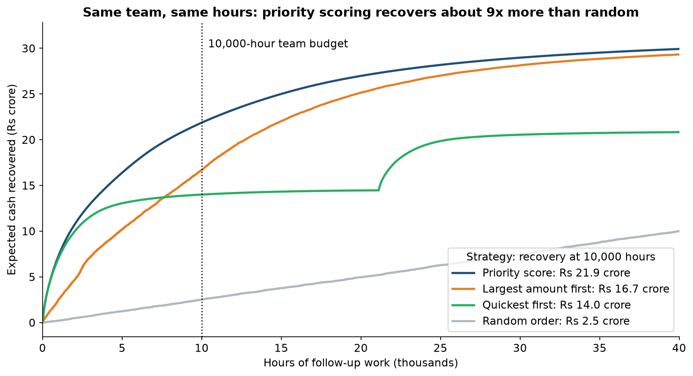
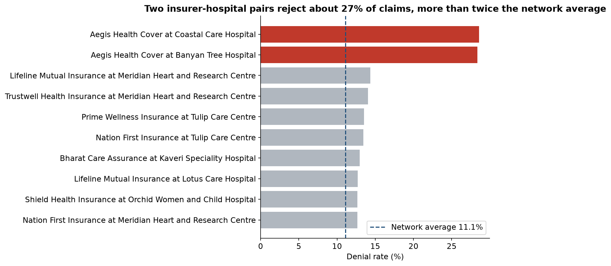
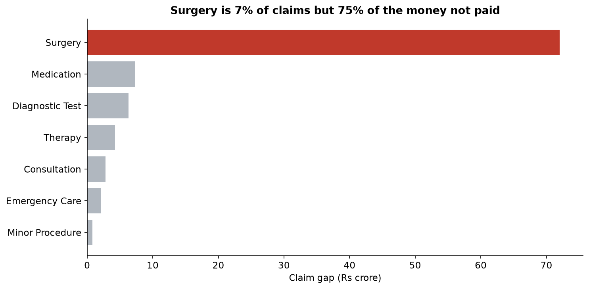
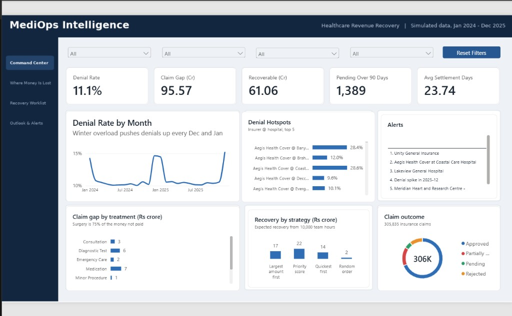
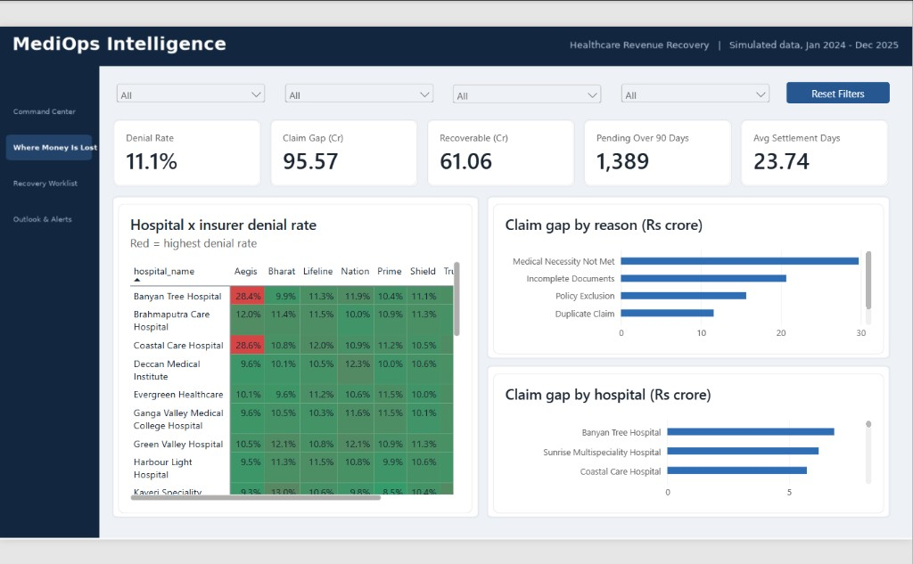
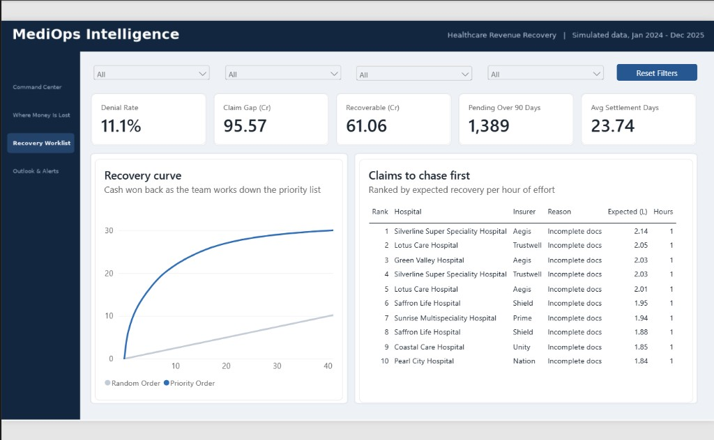
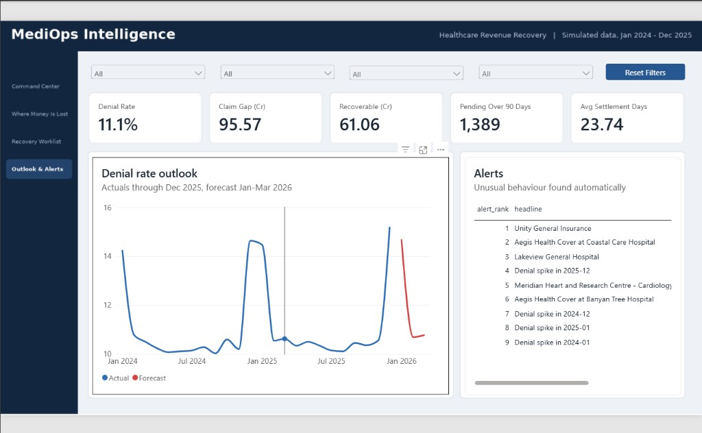

# MediOps Intelligence

**Hospitals do the work but don't always get paid. MediOps finds the unpaid money and tells the finance team which claims to chase first.**

An end-to-end analytics project: simulated data generation, PostgreSQL, SQL analysis, Python (ML, forecasting, anomaly alerts) and a 4-page Power BI dashboard.

> **Data note:** all data is **simulated** (25 fictional hospitals, 8 fictional insurers, 100,000 patients with no names). Real claims data is confidential. Known problems were planted on purpose so the analysis could be tested: if the pipeline finds them, the method works. Results describe this simulation, not real hospitals or insurers.

## The question
A multi-hospital finance team has thousands of denied, part-paid or stuck insurance claims and limited staff time. **Which claims should they appeal, correct or follow up first?**

## Headline result
With the same 10,000 hours of staff effort, chasing claims in priority order recovers about **9x more** than random order.

| Strategy (10,000 hours) | Expected recovery |
|---|---|
| **Priority score** (recoverable x win chance / effort) | **Rs 21.87 Cr** |
| Largest amount first | Rs 16.68 Cr |
| Quickest first | Rs 14.00 Cr |
| Random order | Rs 2.44 Cr |

The top 10% of claims by priority hold 64% of the expected recovery for 6% of the effort.

> **Assumptions:** win chances (Incomplete Documents 70%, Coding Error 60%, Medical Necessity 35%) and effort hours (1 / 2 / 5) are **assumed, not measured**. See "Limitations".

## Key numbers (simulated data)
| KPI | Value |
|---|---|
| Claims | 305,835 |
| Denial rate (decided claims) | 11.1% |
| Approval rate | 73.1% |
| Claim gap (claimed minus approved) | Rs 95.57 Cr |
| Recoverable amount | Rs 61.06 Cr (about 64% of the gap) |
| Preventable denial share | 57.6% |
| Claims pending over 90 days | 1,389 |
| Average settlement time | 23.7 days |

KPI definitions are in [docs/kpi_dictionary.md](docs/kpi_dictionary.md).

## What the analysis found
SQL found all 7 planted problems without being told where to look:
1. Aegis insurer rejects 27-29% of claims at two hospitals (vs about 10%), mostly Incomplete Documents.
2. Cardiology at one hospital rejects 22%, mostly Coding Errors.
3. One insurer takes about 60 days to settle (others about 20).
4. Winter (Dec/Jan) brings about 40% more visits and higher denial rates.
5. One hospital holds all 1,389 claims pending over 90 days.
6. Bills over Rs 2 lakh are denied about twice as often.
7. Surgery is 7% of claims but about three quarters of the claim gap.

## How it was built
| Layer | What | Where |
|---|---|---|
| Design | Problem statement, KPI dictionary, star schema | `docs/` |
| Data | Python generators (fixed seed, reproducible) | `python/generate_*.py` |
| Database | PostgreSQL schema, bulk load, reporting views | `sql/schema.sql`, `sql/load_data.sql`, `sql/reporting_layer.sql` |
| Quality | 27 automatic checks (all pass) | `python/data_quality_checks.py`, `docs/data_quality_report.md` |
| SQL analysis | KPIs, drill-downs, priority score, strategy simulation | `sql/analysis_*.sql` |
| ML | Rejection and shortfall models, compared with a theoretical ceiling | `python/build_features.py`, `python/train_models.py` |
| Forecast | Jan-Mar 2026 volume and denial rate, backtested | `python/forecast.py` |
| Alerts | Robust z-score anomaly detection, 9 alerts, none false | `python/anomaly_alerts.py` |
| Dashboard | 4-page Power BI report | `powerbi/` |

SQL skills used: CTEs, window functions (`RANK`, `NTILE`, running totals), `FILTER`, joins across fact and dimension tables, date arithmetic.

## Dashboard (Power BI, 4 pages)
1. **Command Center:** KPIs, monthly trend, denial hotspots, alerts, recovery by strategy
2. **Where Money Is Lost:** hospital x insurer heatmap, denial reasons, gap by hospital
3. **Recovery Worklist:** priority vs random curve and the top 10 claims to chase
4. **Outlook & Alerts:** forecast and all 9 alerts

**1. Command Center**

**2. Where Money Is Lost** (the red cells are Aegis at Banyan Tree and Coastal Care)

**3. Recovery Worklist** (priority order vs random order, and the first 10 claims to chase)

**4. Outlook & Alerts** (forecast for Jan-Mar 2026 and the 9 automatic alerts)

## Honest notes on the machine learning
- Inputs known only after a decision (approved amount, rejection reason, settlement date) are never used (no leakage).
- Train and test are split by time: train before 1 Jul 2025, test after.
- AUC is about 0.53 for rejection. That looks weak, but the **theoretical ceiling** (the best any model could do if it knew the exact rules that built the data) is 0.533. The model reaches 99.8% of it. In simulated data, outcomes are random draws with raised odds, so the ceiling is low. Real denial models would use signals not simulated here (documentation completeness, prior authorisation).
- The strongest result in this project is the SQL recovery-priority analysis, not the model.

## Limitations
- Simulated data: patterns were planted, so "finding" them tests the method, not the real world.
- Win chances and effort hours are assumptions. A sensitivity test (500 random assumption sets plus named stress scenarios) is in [docs/sensitivity_report.md](docs/sensitivity_report.md): the priority score was 5.5x to 15.4x better than random order (median about 10x) when the team knows the true values. When the team ranked with our base values and reality differed, it was still at least 5.4x better in all 500 random scenarios (best strategy in 458 of 500), and 3.0x in the worst named case (assumptions fully reversed). The advantage shrinks when staff time is plentiful.
- Forecast error is very low (0.8% on claim volume) partly because simulated seasonality repeats exactly. Treat it as a best case.
- Only 24 months of history.

## How to run
1. Create the Python environment and install: pandas, SQLAlchemy, python-dotenv, matplotlib, scikit-learn, psycopg2.
2. Create a PostgreSQL database `mediops` and a private `.env` file with your database credentials (never commit `.env`).
3. Run the generators in this order: hospitals, departments, insurers, patients, visits, bills, claims (`python/generate_*.py`).
4. In PostgreSQL run `sql/schema.sql`, `sql/load_data.sql`, then `sql/reporting_layer.sql`.
5. Run `python/data_quality_checks.py`, then the analysis scripts as needed.
6. Run `python/export_dashboard_tables.py`, then connect Power BI to the `report_*` tables.

## Project documents
- [Problem statement](docs/problem_statement.md)
- [KPI dictionary](docs/kpi_dictionary.md)
- [Data model](docs/data_model.md)
- [Planted stories](docs/planted_stories.md)
- [Data quality report](docs/data_quality_report.md)
- [Learning log](docs/learning_log.md)

## Tools
Python, pandas, scikit-learn, PostgreSQL, SQL, Power BI (DAX), Git.
