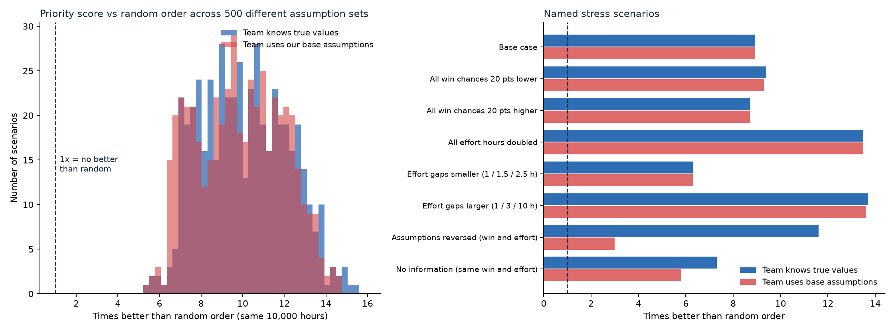

# Sensitivity Analysis

Generated by `python/sensitivity_analysis.py`. All data is simulated.

## Why this test exists
The headline result (priority score recovers about 9x more than random order) depends on two
**assumed** inputs per denial reason: the chance of winning an appeal and the staff hours needed.
They are documented assumptions, not measured values. This test asks whether the conclusion
survives if those assumptions are wrong.

Base assumptions: win chance Incomplete Documents 70%, Coding Error 60%, Medical Necessity Not Met 35%;
effort Incomplete Documents 1 h, Coding Error 2 h, Medical Necessity Not Met 5 h.
Population: 49,069 recoverable claims, 10,000 team hours.

Two modes are used:
- **Team knows**: the team ranks claims using the true values (what you get after re-estimating).
- **Team assumes**: the team ranks with our base assumptions, but reality is different (the harder test).

"Random order" is averaged over 20 shuffles, so it differs slightly from the single
shuffle in `sql/analysis_05_strategy_simulation.sql`.

## 1. Base case check
| Strategy | Recovery (Rs Cr) |
|---|---|
| Priority score | 21.87 |
| Largest amount first | 16.68 |
| Quickest first | 14.00 |
| Random order | 2.46 |

Priority vs random: **8.9x**; priority vs largest-first: **1.31x**.

## 2. Named stress scenarios
| Scenario | Priority (Cr), team knows | Random (Cr) | x random, team knows | Priority (Cr), team assumes | x random, team assumes | Best of 4? (assumes) |
|---|---|---|---|---|---|---|
| Base case | 21.87 | 2.46 | 8.9 | 21.87 | 8.9 | yes |
| All win chances 20 pts lower | 14.11 | 1.5 | 9.4 | 14.0 | 9.3 | yes |
| All win chances 20 pts higher | 29.78 | 3.41 | 8.7 | 29.74 | 8.7 | yes |
| All effort hours doubled | 16.39 | 1.22 | 13.5 | 16.39 | 13.5 | yes |
| Effort gaps smaller (1 / 1.5 / 2.5 h) | 24.79 | 3.92 | 6.3 | 24.54 | 6.3 | yes |
| Effort gaps larger (1 / 3 / 10 h) | 19.29 | 1.4 | 13.7 | 19.04 | 13.6 | yes |
| Assumptions reversed (win and effort) | 27.1 | 2.34 | 11.6 | 7.04 | 3.0 | NO |
| No information (same win and effort) | 22.42 | 3.08 | 7.3 | 17.82 | 5.8 | NO |

## 3. Different time budgets (base assumptions)
| Team hours | Priority (Cr) | Largest (Cr) | Quickest (Cr) | Random (Cr) | x random |
|---|---|---|---|---|---|
| 2,500 | 11.93 | 6.01 | 10.88 | 0.61 | 19.5 |
| 5,000 | 16.39 | 10.19 | 13.05 | 1.22 | 13.5 |
| 10,000 | 21.87 | 16.68 | 14.0 | 2.46 | 8.9 |
| 20,000 | 26.98 | 25.15 | 14.46 | 4.93 | 5.5 |
| 40,000 | 29.93 | 29.33 | 20.83 | 9.9 | 3.0 |

With a very large budget every strategy works almost every claim, so the strategies converge.
The priority score matters most when time is scarce.

## 4. Monte Carlo: 500 random assumption sets
Each scenario draws win chances and effort hours at random from plausible ranges:
win chance Incomplete Documents 50%-90%, Coding Error 40%-80%, Medical Necessity Not Met 15%-55%;
effort Incomplete Documents 0.5-2 h, Coding Error 1-4 h, Medical Necessity Not Met 2-10 h.

| Mode | 5th pct / median / 95th pct (x random) | Worst scenario | Priority best of 4 |
|---|---|---|---|
| Team knows | 7.0x / 9.9x / 13.4x | 5.5x | 500 of 500 |
| Team assumes (base values) | 6.7x / 9.8x / 13.2x | 5.4x | 458 of 500 |

Priority vs largest-first (median): team knows 1.37x,
team assumes 1.36x.

## Conclusion
- The exact "9x" depends on the assumptions. Across 500 plausible assumption sets the
  priority score was between 5.5x and 15.4x better than random order
  when the team knows the true values, and between 5.4x and 14.6x
  when the team ranks with our base assumptions and they turn out wrong.
- Report the result as a **range with a median** (about 10x), not as a single "9x".
- Priority was the best of the four strategies in 500 of 500 scenarios when the team
  knows the true values, but only in 458 of 500 when the team ranks with wrong
  assumptions. In the other 42 scenarios a different strategy recovered
  more. Wrong assumptions cost some of the advantage.
- Even in the worst named case (assumptions completely reversed) the priority ranking was still
  3.0x
  better than random order. It never fell below random in any scenario.
- The advantage shrinks as the time budget grows (3.0x at
  40,000 hours), because with enough time every strategy works most claims.
  The method matters most when staff time is scarce.
- Recommended action: measure real win chances and effort from past appeals, then re-run this ranking.
- Limit: the scenarios vary win chance and effort only. They do not test a different claim population
  or different simulated amounts.
